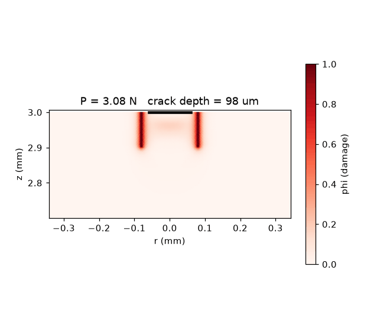

# Glass cone crack – axisymmetric phase-field simulation

Axisymmetric (r, z) AT2 phase-field fracture model of a glass plate under a Hertzian contact load
(steel ball, quasi-static), showing the formation of a cone crack. Built with
[scikit-fem](https://github.com/kinnala/scikit-fem).



## Files
- `glass_cone_crack_phasefield_fixed.py` – simulation. Saves a snapshot of the damage field φ at every load step.
- `animate.py` – turns the saved snapshots into a GIF.

## Install
```
pip install scikit-fem scipy numpy matplotlib pillow
```

## Run
```
python glass_cone_crack_phasefield_fixed.py --ell 0.008 --hfac 2 --nsteps 36 --pmin 1.0 --pmax 3 --flaw_r 0.08 --flaw_depth 0.1 --out grow
python animate.py grow.npz
```

Outputs: `grow.png` (final damage field and load–crack-depth curve), `grow.npz` (data), `grow.gif` (animation).
A run takes roughly 5–10 minutes.

## Model summary
- Glass: E = 70 GPa, ν = 0.22, Gc = 8 J/m²; steel ball: E = 200 GPa, ν = 0.30.
- Load: Hertz contact pressure p(r) = p0·sqrt(1 − (r/a)²) on r < a.
- AT2 phase field, spectral strain-energy split, history field H = max(ψ⁺) for irreversibility, staggered solution.
- An initial surface flaw (φ = 1 band) is prescribed at `--flaw_r` with depth `--flaw_depth`.

## Change from the original script
The tension/compression switch used the sign of the volumetric strain, which is ≈ 0 in the pure-shear state just
outside the contact edge, so the flaw was not degraded and the crack never grew. It now uses the maximum principal
strain (`max(e1, e3) > 0`). With this change the crack grows from about 4.3 N in the example above.

## Caveats
- Results were checked only for the parameters above. At the crack-growth steps the staggered iteration reaches its
  iteration limit (unstable crack jump), so use more load steps (`--nsteps`) before trusting numbers.
- The damage zone is wide because the length scale ell (8 µm) is not small relative to the crack; the cone angle
  has not been verified against theory.
- Based on a script provided by the author's course/source; check its licence before making the repository public.
